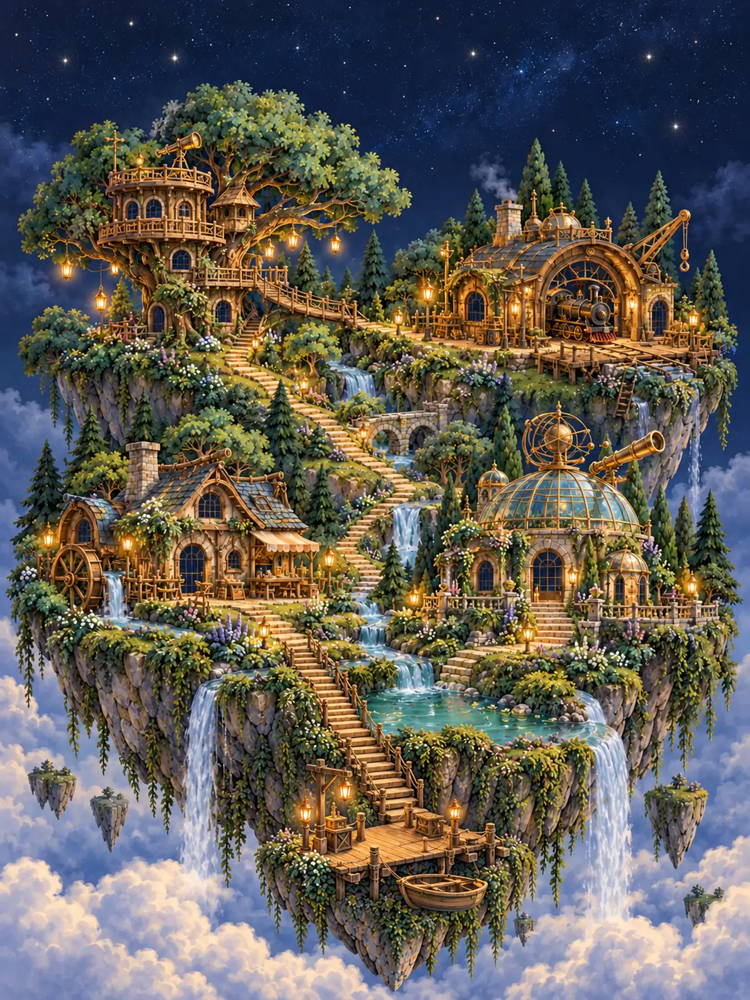
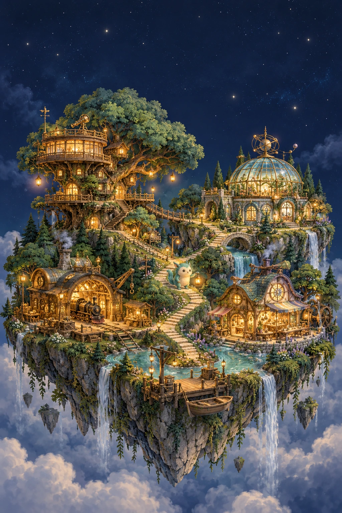

# 《看見小宇宙》美術交接包

2026-10-12｜ChatGPT 美術製作｜Claude 網頁開發

## 現在的 v2 網站：先讀這裡

已依 Claude 最新 `docs/ART_SPEC_for_ChatGPT.md` 完成18張正式接入圖片，直接放在本目錄，檔名與 v2 程式相符。請優先閱讀 [CLAUDE_V2_ART_HANDOFF.md](CLAUDE_V2_ART_HANDOFF.md) 與 [v2-manifest.json](v2-manifest.json)。

下列 images/ 素材為原腳本的美術備選，供未來擴充；不要以原腳本覆蓋 Claude 現有 v2 的遊戲設計。

## 先閱讀

- 網站規則與文案：[網站設計腳本](../../docs/WEBSITE_DESIGN_SCRIPT.md)。
- 接入與動畫方向：`CLAUDE_ART_HANDOFF.md`。
- 19 個正式圖片檔：`images/`；尺寸與透明資訊：`manifest.json`。
- 原始生圖提示：`PROMPTS.json`，使用內建 imagegen 生成。
- 圖片已轉為 WebP：場景品質 92；透明道具使用無損 WebP，保留原始 alpha。

## 主視覺

## 場景與卡片

| 檔名（images/ 下） | 用途 |
| --- | --- |
| hero-island-mobile.webp | 1024×1536 手機首頁／探索地圖 |
| hero-island-desktop.webp | 1536×1024 寬螢幕主視覺 |
| scene-parent-treehouse.webp | 家長觀察樹屋，桌面留空 |
| scene-repair-workshop.webp | 機關修理所，桌面疊放程式軌道 |
| scene-imagination-river.webp | 奇想工坊河岸，疊放毛球與方案 |
| scene-observatory.webp | 線索觀星臺，桌面疊放植物 |
| parent-card-01-questions.webp | 為什麼後面還有為什麼 |
| parent-card-02-deep-interest.webp | 深入研究興趣 |
| parent-card-03-noticing.webp | 發現規律與細節 |
| parent-card-04-other-way.webp | 嘗試另一個辦法 |
| parent-card-05-different-rhythms.webp | 不同面向的節奏與協助 |
| parent-card-06-expression.webp | 豐富想法與表達方式 |
| mascot-xiaoguang-atlas.webp | 小光四種姿勢，2×2 透明圖集 |
| workshop-tools-atlas.webp | 三工具、毛球、星星車、燈塔，3×2 透明圖集 |
| observatory-props-atlas.webp | 兩株植物、花盆、太陽、水壺、裝飾尺，3×2 透明圖集 |
| river-proposal-bridge.webp | 橋的提案示意，透明獨立圖 |
| river-proposal-boat.webp | 船的提案示意，透明獨立圖 |
| river-proposal-zipline.webp | 上方運送的提案示意，透明獨立圖 |
| keepsake-card-background.webp | 1024×1536 探索紀念卡，中央文字留白 |

真實課程照片、學校名稱、簡章及報名資料需由學校提供；幻想插畫不能當作學校實況。
